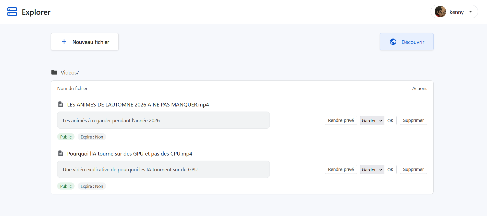

# Explorer

A self-hosted file sharing app in plain PHP. No framework, no Composer, no database — the only requirement is PHP with `ext-fileinfo`.




## Features

- Upload files into optional folder paths
- Require a description for every uploaded file
- Public or private visibility per file
- Discover explicitly configured Explorer peers, their public files, and message them
- Share profile avatars securely between configured peers
- Configurable expiry (1h – 30d, or never)
- Automatic expiry cleanup via a cron endpoint
- CSRF protection on all mutating actions
- Bcrypt password hashing, session fixation protection, brute-force delay
- Profile avatar upload (JPEG, PNG, or WebP) and password change from the account menu
- `Content-Security-Policy` and `X-Content-Type-Options` headers

## Requirements

- PHP 8.2+ with the `fileinfo` extension
- Nginx (or Apache) — see configuration below

## Installation

```bash
git clone <repo> Explorer
cd Explorer
cp .env.example .env
```

Edit `.env`:

```bash
USERNAME=admin

# Generate a bcrypt hash for your password:
# php -r "echo password_hash('yourpassword', PASSWORD_BCRYPT);"
PASSWORD=$2y$12$...

# Generate a random cron secret:
# php -r "echo bin2hex(random_bytes(32));"
CRON_SECRET=...
```

Create the required directories and make them writable by the PHP-FPM user:

```bash
mkdir -p uploads data
chown www-data: uploads data   # replace www-data with your PHP-FPM user if different
```

## Development server

```bash
make serve
# → http://localhost:8000
```

To use a different port, set `PORT`:

```bash
make serve PORT=8080
```

## Tests

The project has no dependencies and no test framework. Run the smoke test with PHP alone:

```bash
make test     # or: php tests/smoke.php
make check    # lint and test, the same commands CI runs
```

It copies the app to a temporary directory, starts the built-in server against that copy, and exercises the cron endpoint. Your real `.env`, `uploads/`, and `data/` are never touched.

## Project structure

```
src/
  index.php       — bootstrap, constants, router
  handlers.php    — route handlers and view renderers
  helpers.php     — env loading, metadata I/O, path and output utilities
  router.php      — PHP built-in server router (dev only)
  style.css       — dashboard styles
  views/
    login.php     — login page
    dashboard.php — file management dashboard
    discover.php  — configured peers and their public files
    messages.php  — peer conversation
uploads/          — uploaded files (mirrors user-supplied folder structure)
data/
  files.json      — file metadata (path, description, private, expires, uploaded)
password.json     — optional updated password hash (created by the profile menu, permissions 0600)
profile/          — private profile avatar storage (not web-accessible)
peers.json        — peers added from the Discover page (shared tokens; file permissions 0600)
  .peers.lock     — peer configuration lock (created automatically)
  messages/       — JSON conversation histories, one file per peer
  .lock           — flock coordination file (created automatically)
.env              — credentials and secrets (not web-accessible)
```

Changing the password from the profile menu stores the new password hash in
`data/password.json`; this overrides `PASSWORD` from `.env` without rewriting
the environment file. Back up `data/` to preserve this change.
Profile pictures are limited to 5 MiB and JPEG, PNG, or WebP, and are served
only to an authenticated user. A configured peer can retrieve the avatar only
with its shared bearer token; conversation pages proxy that image without
exposing the token to the browser.

## Routes

| Method | Path | Description |
|--------|------|-------------|
| `GET` | `/` | Login form (unauthenticated) or dashboard |
| `POST` | `/login` | Authenticate |
| `GET` | `/logout` | End session |
| `POST` | `/upload` | Upload a file |
| `POST` | `/api/upload` | Upload a file with `API_UPLOAD_SECRET` and a required description |
| `GET` | `/discover` | List explicitly configured peers and their public files (login required) |
| `POST` | `/peers/add` | Add a trusted peer from the Discover page (login and CSRF required) |
| `POST` | `/peers/delete` | Remove a peer added from the Discover page (login and CSRF required) |
| `GET` / `POST` | `/messages/{username}` | View or send messages to a configured peer (login required) |
| `GET` | `/api/messages/{username}` | Authenticated same-origin endpoint polled by the chat page |
| `GET` | `/api/peer/files` | Authenticated peer API for public file listings |
| `GET` / `POST` | `/api/peer/messages` | Authenticated peer API for messaging |
| `GET` | `/download/{path}` | Download a file (403 if private and not logged in) |
| `POST` | `/delete/{path}` | Delete a file |
| `POST` | `/toggle/{path}` | Toggle public/private |
| `POST` | `/expiry/{path}` | Set or update expiry |
| `GET` | `/cron` | Delete expired files (403 without a valid `X-Cron-Secret` header or `?secret=` parameter) |
